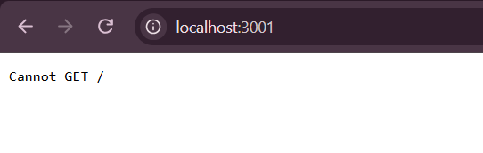
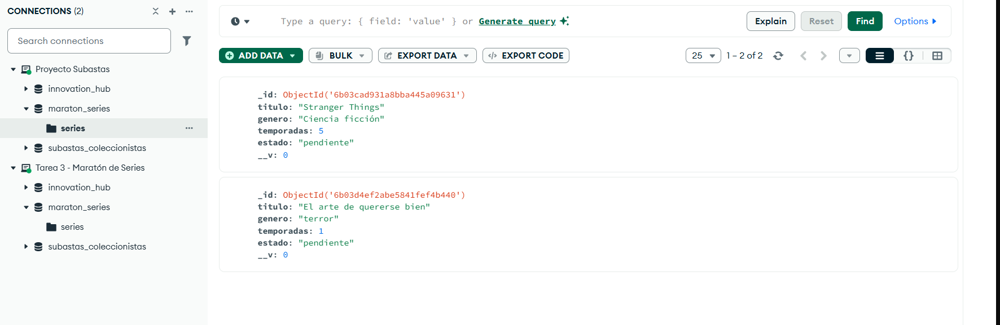


# Laboratorios — Maratón de Series

## 1. React y componentes

Se desarrolló una aplicación React para administrar una colección personal de series.

### Implementación
- Componentes reutilizables.
- Uso de useState para manejar datos.
- Uso de useEffect para consultar la API.
- Formularios controlados.
- Búsqueda y filtros por estado.

### Reflexión
React permite organizar la interfaz en componentes y actualizar la información sin recargar la página.

### Evidencia
Se verificó el funcionamiento del tablero React, incluyendo la consulta de series, la búsqueda, los filtros y la navegación.

## 2. React Router

Se implementó navegación mediante react-router-dom.

### Rutas
- `/`: tablero principal.
- `/nueva`: formulario para agregar series.
- `/serie/:id`: detalle de una serie.

### Reflexión
React Router permite crear diferentes vistas dentro de una aplicación de página única.

### Evidencia

## 3. Express y API REST

Se desarrolló un servidor Express con las siguientes operaciones:

- GET /api/series
- GET /api/series/:id
- POST /api/series
- PATCH /api/series/:id
- DELETE /api/series/:id

### Reflexión
La API separa la interfaz React de la lógica del servidor.

### Evidencia

## 4. MongoDB

Se integró MongoDB mediante Mongoose.

### Implementación
- Conexión local a MongoDB.
- Base de datos maraton_series.
- Colección de series.
- Persistencia de datos.
- Validación de los datos recibidos.

### Prueba realizada
Se agregó una serie desde React y se comprobó su almacenamiento en MongoDB Compass.

### Reflexión
MongoDB permite conservar los datos después de reiniciar el servidor, a diferencia de un arreglo en memoria.

### Evidencia

## 5. ASP.NET Core y Entity Framework Core

Se desarrolló una API con ASP.NET Core y Entity Framework Core 8.

### Implementación
- Modelo Serie.
- Modelo Miembro.
- DbContext SeriesDb.
- Configuración del proveedor SQL Server.
- GET /api/series.
- GET /api/miembros.

### Pruebas realizadas
- Compilación correcta con dotnet build.
- Generación de la migración Inicial mediante dotnet ef migrations add Inicial.

### Verificación realizada
Se aplicó correctamente la migración Inicial en SQL Server Express. Se comprobó la conexión a la base MaratonSeries y se ejecutaron los endpoints GET /api/series y GET /api/miembros, ambos con respuesta correcta y listas vacías.

### Reflexión
Entity Framework Core permite representar tablas mediante clases de C# y gestionar cambios en el esquema mediante migraciones.

### Evidencia
Se verificó la compilación con 0 errores y 0 advertencias, la aplicación de la migración Inicial en SQL Server Express y las respuestas de los endpoints GET /api/series y GET /api/miembros.

